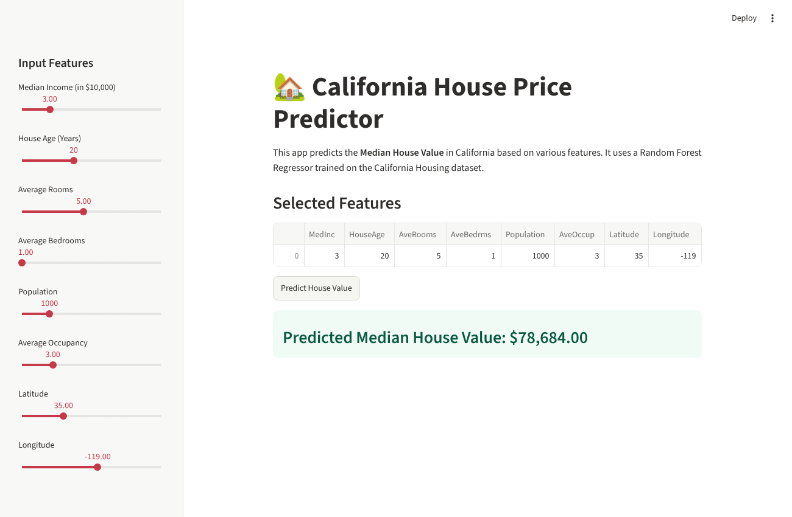

# California House Price Prediction

Predicts the median house value of a California district from census features, comparing linear regression with a tuned Random Forest, and serves the model in a Streamlit app.


## Dataset

The [California Housing dataset](https://scikit-learn.org/stable/datasets/real_world.html#california-housing-dataset) (1990 US census): 20,640 districts, no missing values, 8 features. Median income, house age, average rooms and bedrooms, population, average occupancy, latitude and longitude. The target `MedHouseVal` is in units of $100,000.

## Workflow

1. **Clean:** check for missing values (none) and remove duplicates.
2. **Explore:** target distribution and correlation heatmap. Median income is by far the strongest single predictor.
3. **Scale:** `StandardScaler`, needed for linear regression; tree models are unaffected.
4. **Split:** 80/20 (16,512 train / 4,128 test, `random_state=42`).
5. **Model:** Linear Regression baseline vs. Random Forest.
6. **Tune:** `GridSearchCV` over `n_estimators ∈ {50, 100}` and `max_depth ∈ {10, 20, None}` with 3-fold CV.
7. **Interpret:** feature importances from the tuned forest.

## Results

Test set of 4,128 districts. All figures come from the executed notebook in this repo.

| Model | RMSE | RMSE ($) | R² |
|---|---|---|---|
| Linear Regression | 0.746 | ≈ $74,600 | 0.576 |
| Random Forest (50 trees) | 0.507 | ≈ $50,700 | 0.804 |
| **Tuned Random Forest** (100 trees, no depth limit) | **0.506** | **≈ $50,600** | **0.804** |

The Random Forest cuts error by about a third compared with the linear model, because house value depends non-linearly on income and location. Tuning added very little over the default forest, so most of the gain comes from switching model families, not from hyperparameters.

## App



Adjust the eight features in the sidebar and click **Predict House Value**.

## Run it

```bash
git clone https://github.com/sahithi-manda/House-Price-Predictor.git
cd House-Price-Predictor
python -m venv venv && source venv/bin/activate   # Windows: venv\Scripts\activate
pip install -r requirements.txt
streamlit run app.py
```

The trained model isn't stored in Git: a fully grown 100-tree forest is about 33 MB even compressed. On first launch the app trains it automatically in a few seconds and caches it as `rf_model.joblib`. To train it yourself and print the test metrics:

```bash
python train.py
```

## Files

```
├── House_Price_Prediction.ipynb   # EDA, model comparison, tuning, feature importance (with outputs)
├── train.py                       # Reproduces the final model in one step
├── app.py                         # Streamlit app
├── california_housing.csv
└── Project_Report.md
```

## Next steps

- Add engineered features such as rooms per household and distance to the coast, and try gradient boosting.
- Use cross-validated RMSE for the final comparison instead of a single split.
- Cap or model the target separately: values are clipped at $500,000 in the source data, which biases predictions for expensive districts.
